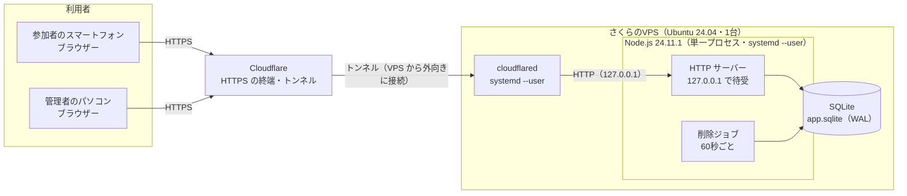
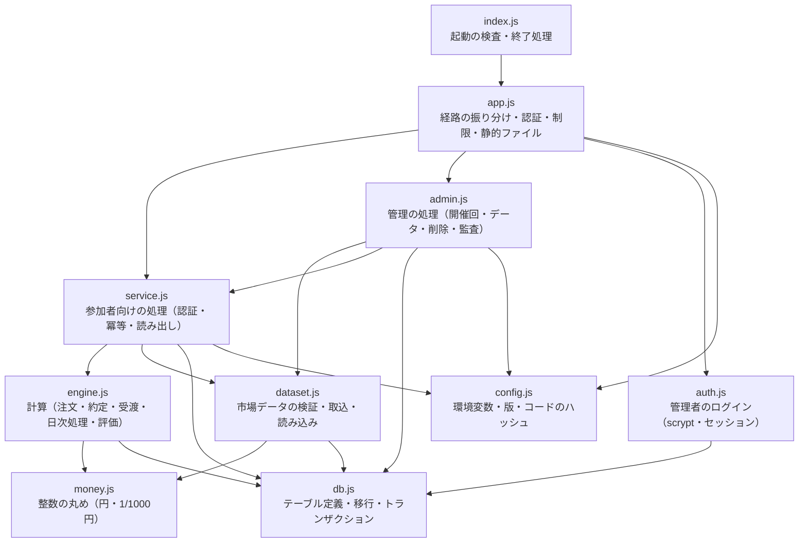
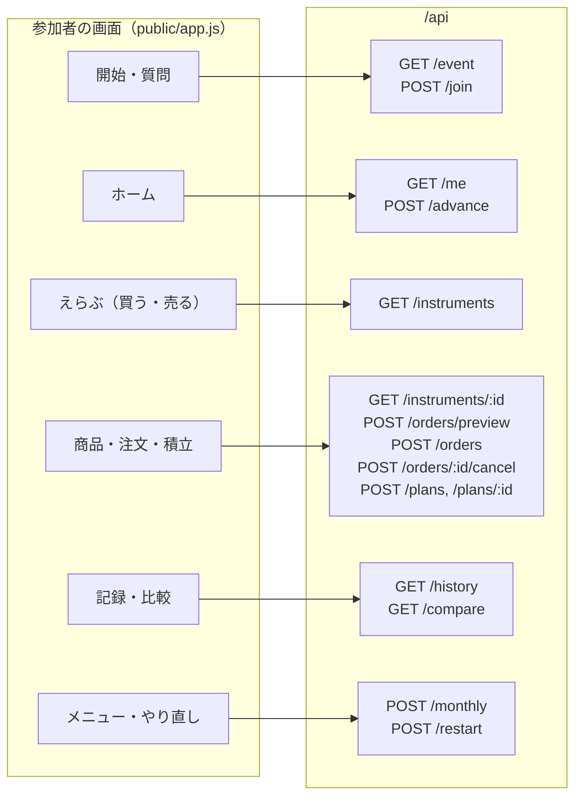
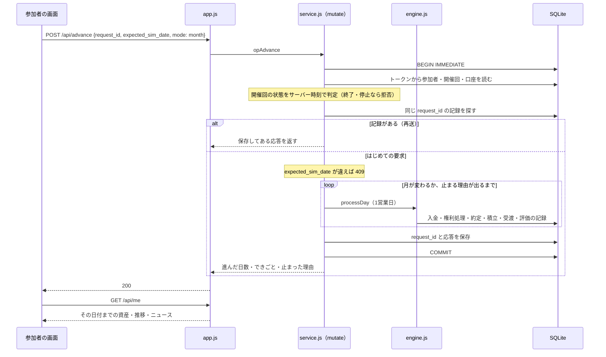
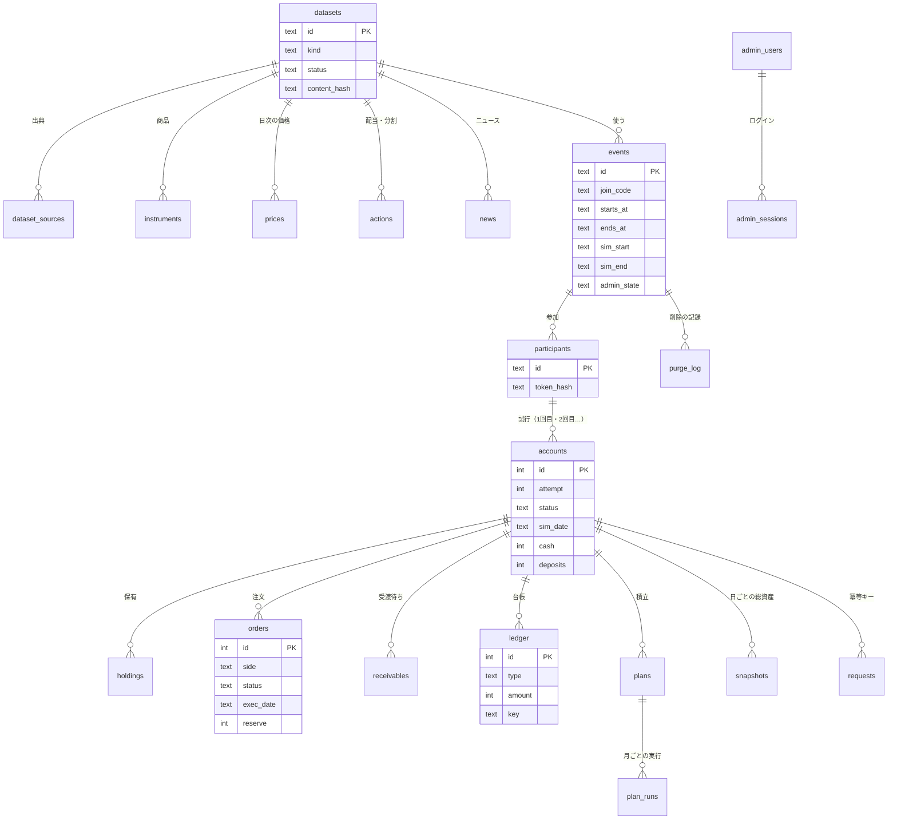
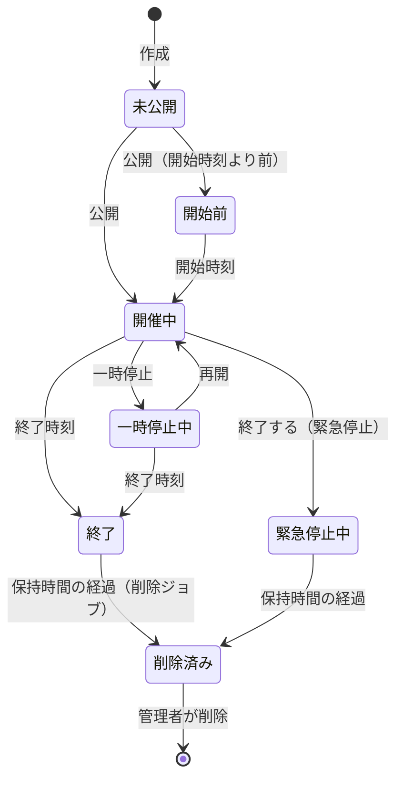
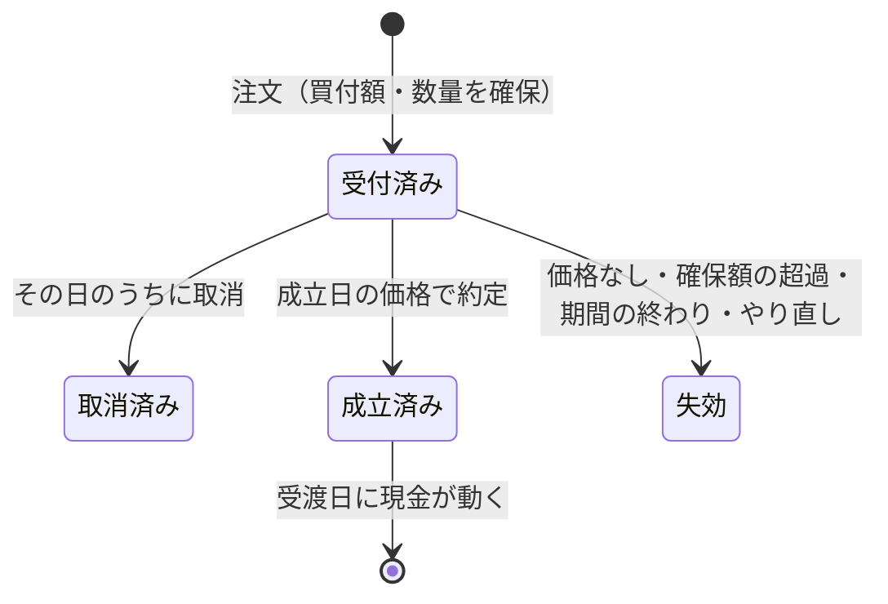
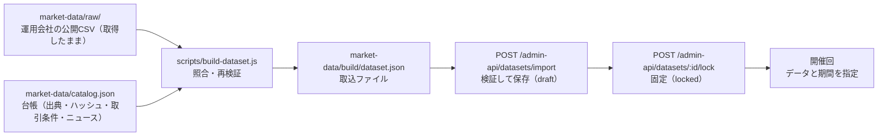
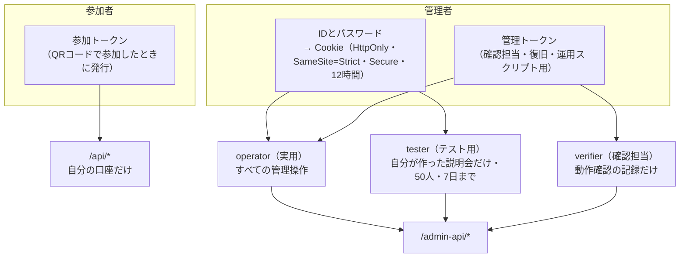

# 設計図（技術者向け・アプリ 0.11.1）

資産形成シミュレーターの構成を、図でまとめたもの。文章での説明は [DESIGN.md](DESIGN.md)（基本設計）、[SPEC.md](SPEC.md)（計算の詳細）、[API.md](API.md)（API）にある。この文書は、それらを読む前の見取り図として使う。

図は Mermaid で書いてある（GitHub ではそのまま図として表示される）。

## 1. 全体の構成（確認用環境の実際の配置）

- 外から VPS へ直接つながる入口は開けていない（パケットフィルターで許可しているのは SSH だけ）。アプリは 127.0.0.1 で待ち受け、cloudflared が VPS から Cloudflare へ外向きに接続して、そこを通って要求が届く。
- プロセスは1つ、データベースはファイル1つ。外部のサービス（認証基盤・解析・CDN など）は使っていない。npm の依存パッケージもない（QRコードの生成だけ、MIT ライセンスの `public/vendor/qrcode.js` を同梱）。
- 環境は `APP_ENV` で分かれる: `prod`（厳格。許諾・確認の記録がそろわないと公開できない）、`staging`（確認用。未確定の項目を画面に表示したうえで動く）、`dev`（開発・検算用。127.0.0.1 でしか起動しない）。

## 2. サーバーのモジュール構成

| ファイル | 役割 |
|---|---|
| `server/index.js` | Node の版・トークンの長さ・待受アドレスを検査して起動する。終了時は処理中の要求を待ってからデータベースを閉じる |
| `server/app.js` | `/api/*`（参加者）、`/admin-api/*`（管理者）、`/healthz`、静的ファイルを振り分ける。回数制限、応答ヘッダー（CSP など）、管理者の認証と権限の判定もここ |
| `server/service.js` | 参加者の認証、開催回の状態の判定、冪等キーによる再送の扱い、画面に返す内容の組み立て。更新はすべて `mutate()` を通る |
| `server/engine.js` | 計算の本体。注文の検証、1営業日ごとの処理、資産の評価、NISA と普通の口座の比較 |
| `server/admin.js` | 開催回の作成・変更・公開・停止・削除、市場データの取込と固定、保持時間、監査ログ |
| `server/auth.js` | 管理者アカウント（scrypt のハッシュ）と、ログインのセッション |
| `server/dataset.js` | 取込ファイルの検証（期間・重複・欠損・禁止語など）と、メモリ上の読み込み（キャッシュ） |
| `public/app.js` | 参加者の画面。計算はせず、サーバーの結果を表示するだけ |
| `public/admin.js` | 管理者の画面 |

## 3. 画面とAPIの対応

- 参加者は、参加したときに発行されるトークン（`Authorization: Bearer`）で識別する。サーバーにはトークンの SHA-256 だけを保存する。氏名などは受け取らない。
- 画面から日付や残高は送らない。更新の要求に付けるのは、冪等キー（`request_id`）と、画面が見ている日付（`expected_sim_date`。食い違えば 409）だけ。
- 通信が切れて結果が分からないときは、`GET /api/requests/:id` で同じ `request_id` の結果を照会する。

## 4. 更新の要求の流れ（「1か月進める」の例）

- 1営業日の処理順: 月初の入金 → 分割・併合 → 配当・分配金の確定 → 株式・ETF の約定 → 投資信託の約定 → 積立の注文 → 受渡（現金の出入り）→ 資産の評価の記録・ニュース・最終日の判定。早送りも、この1日分のくり返し。
- 「1か月」は、注文の成立・失効、積立の見送り、ニュースの公表があった日で止まる。
- 読み出しでは、その口座の日付より後の価格・ニュースを返さない（サーバー側で切る）。

## 5. データの構造

| まとまり | テーブル | 寿命 |
|---|---|---|
| 市場データ | `datasets`, `dataset_sources`, `instruments`, `prices`, `actions`, `news` | 取込後に固定（ロック）すると変更できない。開催回の削除では消えない |
| 開催回 | `events` | 管理者が削除するまで残る |
| 参加者のデータ | `participants`, `accounts`, `holdings`, `orders`, `receivables`, `ledger`, `plans`, `plan_runs`, `snapshots`, `requests` | 開催回の終了から保持時間（既定24時間）が過ぎると、削除ジョブがまとめて消す |
| 管理 | `admin_users`, `admin_sessions`, `admin_audit`, `purge_log` | 残る（監査ログと削除記録には、参加者の中身を書かない） |

- 金額は円の整数、価格は 1/1000 円の整数で持つ。浮動小数点で金額を計算しない。
- 台帳（`ledger`）は `(account_id, key)` が一意で、同じ入金や受渡を二重に記録できない。現金残高は、台帳の現金に関わる行の合計と常に一致する（自動テストで全営業日を検査）。
- 総資産 ＝ 現金 ＋ 保有の評価額 − 未受渡の買付代金 ＋ 未受渡の売却代金 ＋ 未収の配当等。

## 6. 状態の移り変わり

### 開催回

状態はデータベースに持つ値（`admin_state`）とサーバー時刻から、要求のたびに求める。データや計算に関わる設定が公開後に変わると、公開は取り消される（本番環境では、さらに動作確認の記録が現在の構成と一致していることが条件）。

### 注文

## 7. 市場データが画面に出るまで

- 元のCSVと生成した取込ファイルは、利用許諾が未確認のためリポジトリに入れていない（`.gitignore`）。台帳に取得元とハッシュがあり、同じファイルかどうかを照合できる。
- 価格は元の値のまま使う（補完・調整・予測をしない）。空欄の分配金を0円に置き換えない。
- ニュースの解説と「考え方の例」は、取込のときに禁止語（売買のすすめや値動きの見通しにあたる表現）を検査する。

## 8. 認証と権限

- パスワードは scrypt のハッシュ（アカウントごとのソルト）で保存する。セッションとトークンは SHA-256 だけを保存する。
- ログインの失敗は、送信元ごとに1分10回まで。同じIDで5回続くと、そのIDは15分使えない。
- Cookie で認証した変更操作は、同じサイトの画面からの要求だけを受け付ける（Origin を照合）。
- 管理者の画面とAPIからは、参加者一人ひとりの口座・注文の中身を読めない（人数と件数だけ）。

## 9. 主な設計上の決めごと

| 決めたこと | 理由 |
|---|---|
| 単一プロセス＋SQLite | 説明会1回の規模（数十〜数百人）なら足り、運用する部品が少ない。300人・60秒の負荷を手元で確認済み（[TEST_REPORT.md](TEST_REPORT.md)） |
| 計算はすべてサーバー | 画面から残高や日付を受け取らないので、端末側の改変で結果を変えられない |
| 金額は整数 | 丸めの位置を仕様として決められる（[SPEC.md](SPEC.md) §0） |
| 更新はすべて冪等キーつき | 会場のWi-Fiで通信が切れても、二重の注文・二重の進行が起きない |
| 未来の情報はサーバーで切る | 画面のコードを読んでも、その日付より後の価格やニュースは手に入らない |
| 参加者のデータは終了後に自動で削除 | 匿名のデータでも残さない。削除の記録には件数だけを残す |
| 依存パッケージなし | 確認する対象を、このリポジトリのコードと Node.js 本体に限る |

## 10. 既知の制約

- `node:sqlite` は Node 24 の時点で実験的機能。検証した版（24.11.1）以外では、本番・確認用環境を起動しない。
- 1台・1プロセスなので、止まれば全体が止まる。冗長化はしていない。
- 市場データの利用許諾、取引条件、ニュースの文言は、さいしんの確認が済んでいない（[LIMITATIONS.md](LIMITATIONS.md)）。
