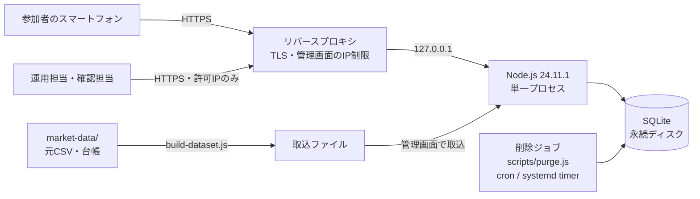
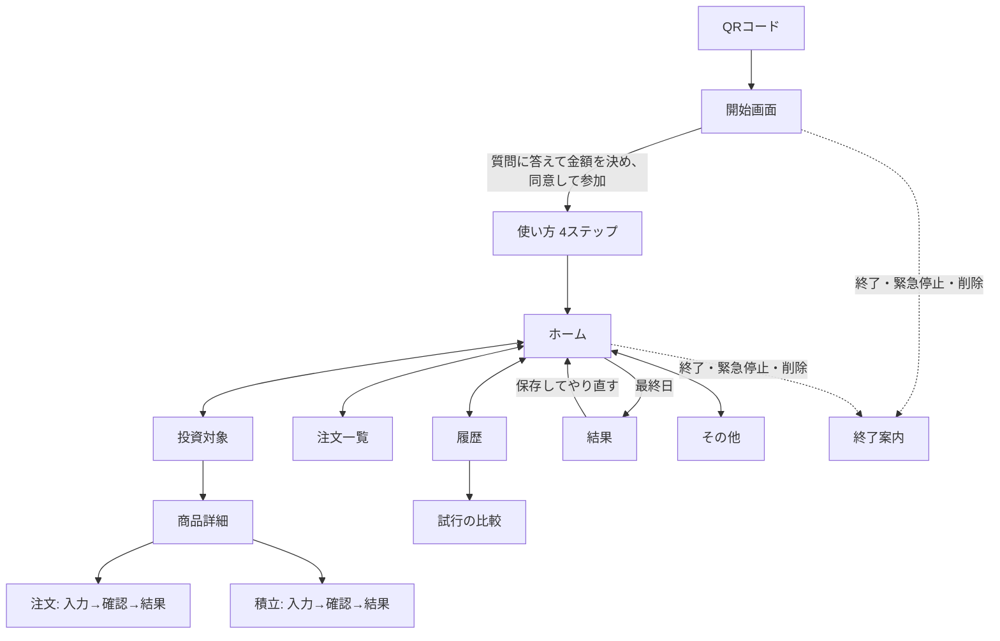
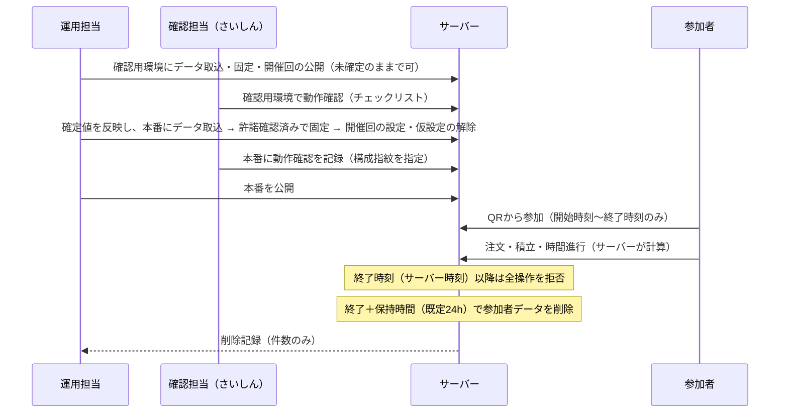
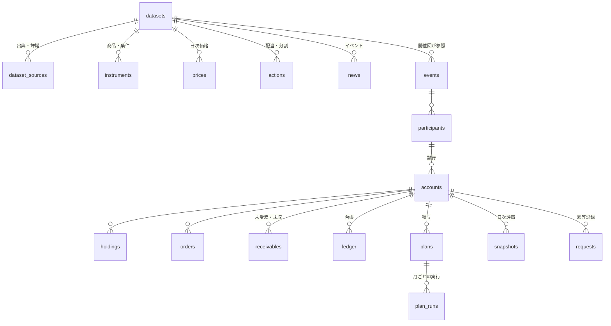

# 基本設計・データ設計（アプリ 0.10.0）

> 図での見取り図は [ARCHITECTURE.md](ARCHITECTURE.md)。

> 0.10.0: 管理画面はログイン必須（IDとパスワード）。アカウントは **実用（operator）** と **テスト用（tester）** の2種類。テーブル `admin_users`（id, role, salt, hash, updated_at）と `admin_sessions`（token_hash, user_id, expires_at, created_at）、`events.created_by` を追加。詳細は OPERATIONS.md §2a。

> 0.9.0 の管理画面: 先頭に「説明会をはじめる」（名前・使える時間・定員を決めて押すと、作成→公開→QRコードの全画面表示まで行う。データは固定済みの最新のもの、期間はその全体、既定の金額は最初100万円・毎月3万円）。一覧の各説明会は「参加人数・QRコードを表示・一時停止／再開・終了」だけを見せ、構成・仮設定・動作確認・保持時間と削除は「くわしく」に入れた。QRの全画面表示は参加人数を5秒ごとに更新する。日時や金額を細かく指定する作成、市場データ、削除記録は「くわしい設定」に折りたたんだ。本番環境では、動作確認の記録がない説明会は公開できないため、「説明会をはじめる」は作成までで止まり、理由を表示する。

> 0.8.0 の見た目: 白地・ゴシック体・緑一色（#00754a）。上部は緑の帯に日付と進み具合。明朝体の数字、字間を空けた小見出し、左だけ色を付けた枠、丸い印・回転した受付印、押したときの拡大縮小・点滅などの演出は使わない。区切りは細い罫線と薄い灰色の面、ボタンは主ボタンだけ緑で他は白地に灰色の枠。

> 0.7.1 の変更: NISA口座と普通の口座の比較は**結果画面だけ**に表示（ホームの1行と「くわしく」からは外した）。ヘッダーの「過去の実データ 期間」の常時表示をやめた（開始画面・ご利用上の注意・結果画面には対象期間と「過去の実データに基づく取引体験」が残る。架空データの開発環境では「架空データ」と表示）。新しいニュースは、時間を進めた直後に**カード**で自動表示する（要約・解説・考え方の例・出典、「閉じる」「売買する」）。管理画面の参加用QRコードは環境変数 PUBLIC_URL の公開URLで作り、「会場用に大きく表示」（全画面・印刷）を追加。

> 0.7.0 の追加: ホームの損益を総資産に近い大きさで表示。利益が出ているときは「NISAなら税金0円・普通の口座なら約○円」の1行を出し、押すと比較表を開く（結果画面と「くわしく」にも表示）。ニュースには折りたたみの「解説と考え方の例」（立場の異なる2つ）を付ける。news テーブルに `explain`, `views_json` を追加。

> 0.6.0 の画面方針: **主要な画面はスクロールなしの1画面に収める**。ホームは「総資産・損益・グラフ・使えるお金・直近のできごと1行・いま押すボタン」だけ。持っているもの・お金の内訳・資産配分・できごとは「くわしく」ページへ、記録はメニューへ移した。下のメニューは3つ（ホーム・えらぶ・メニュー）。注文と積立は全画面のシートで行い、画面を下へ伸ばさない。下の画面一覧のうち、ホームと注文の記述はこの方針で読み替える。

計算・約定・端数の詳細は [SPEC.md](SPEC.md)、APIは [API.md](API.md)、運用は [OPERATIONS.md](OPERATIONS.md)。

## 1. 構成

- サーバーが残高・日付・計算・期限の唯一の正。画面は表示と入力だけで、計算結果を送らない。
- 当日は外部APIに接続しない（市場データは事前に取込・固定。QR生成も同梱ライブラリ）。外部への通信は、ニュースの出典リンクを参加者が開く場合だけ。
- 個人情報・アクセス解析・外部トラッキングなし。Cookie を使わない（認証は `Authorization` ヘッダー）。
- 環境: `prod`（本番。許諾確認・条件確定・仮設定なし・動作確認の記録が公開の条件）/ `staging`（確認用。さいしんの動作確認の場。未確定のままでも動かせ、未確定事項を画面に常時表示）/ `dev`（開発・検算。ループバック限定、赤帯表示）。DB・トークンは環境ごとに別。

## 2. 画面
### 参加者（スマートフォン縦画面優先）
| 画面 | 主な内容 |
|---|---|
| 開始（質問6つ） | 開催名、対象期間と「過去の実データに基づく取引体験」、開催時間、状態 → 1画面1問: 学年／毎月の収入／毎月の支出／毎月投資に回す金額（収入−支出の差し引きを表示）／最初に用意する金額 → 確認（必須文言・同意）→ 参加。収入・支出までは「とばす」ことができる |
| ガイド（押す場所の表示） | 説明のページは出さず、いま押すボタンを輪で囲み、短いことばを添える（さがす → 商品 → 買う → 金額 → 確認 → 注文 → ホーム → 時間を進める）。操作はじゃませず、最初の時間進行で消える。×で消せ、メニューから再表示できる |
| 時間の表現 | ヘッダーに日付・「24か月のうち何か月目」（期間の長さは開催回の設定による）・期間の進み具合の線。時間を進めると、進めた営業日を1日ずつ、日付・総資産・グラフ・線に反映する（1か月で約1.4秒。表示するのはサーバーが返した各日の実績だけ）。終わると「この間 ±◯円（うち入金◯円）」を表示。動きを減らす設定の端末では演出なし |
| ホーム | 総資産・運用損益（税引前）・使えるお金・入金した合計 → 総資産のグラフ → **次にやること**（4段階のどこにいるかと、記号つきのボタン: 1日・1か月・自動）→ 進めた間の出来事（種類ごとにまとめ）→ 持っている投資対象 → 総資産の動き。現金の内訳・受渡予定・資産配分・できごとは折りたたみ。最終日は結果 |
| 投資対象 | 分類・正式名称・現在までの価格、検索、分類絞り込み（評価ラベルなし・登録順） |
| 商品詳細 | 説明、シミュレーション日付までの価格推移、保有、取引条件（仮設定の表示）、出典、**買う・売る・積立** |
| 注文 | 入力 → 内容確認 → 受付結果。使える資金、数量・金額、費用、約定予定日、受渡予定日。通信結果が不明なときは「受付状況を確認」 |
| 記録 | 「注文と積立」（受付済み・取消、積立、成立・取消・失効）と「お金の動き」を切り替え。過去の試行（閲覧専用）、試行の比較 |
| メニュー | いまの条件、やり直し（金額の変更可）、使い方、注意事項、再現していること・出典、用語、データの扱い、説明会の終了予定 |
| 終了 | 終了案内と必須文言のみ（トークンを端末から消去） |

### 管理（`/admin`）
開催回（日時・人数・期間・資金・保持時間・削除予定・仮設定・構成指紋・QR）、データ取込（検証プレビュー → 下書き → 許諾の確認記録 → 固定）、動作確認の記録（確認担当のみ）、公開／一時停止／再開／緊急停止、保持時間の変更（影響表示つき）、即時削除、削除記録。

## 3. 権限
| 操作 | 参加者 | 運用担当 | 確認担当 |
|---|---|---|---|
| 自分の口座の閲覧・注文・進行 | ○ | × | × |
| 他の参加者の口座 | × | ×（件数のみ） | × |
| 開催回・データの管理、公開・停止・削除 | × | ○ | × |
| 動作確認の記録 | × | × | ○ |
| 許諾を「確認済み」にする | × | ○（確認内容のメモ必須・監査記録） | × |

## 4. 利用開始から削除まで

開催回の状態（実効）: `not_enabled`（未公開）→ `unverified`（確認未了・解除）/ `not_started` → `open` ⇄ `paused` → `ended` → `purged`。`stopped`（緊急停止）はどの状態からも遷移し、戻さない運用。確認後にコード・データ・計算に関わる設定・仮設定が変わると、構成指紋が変わり `unverified` に戻る。

## 5. 取引処理の方針
- 更新は `BEGIN IMMEDIATE` の1トランザクション（単一プロセスで直列化）。終了判定・再認証も同じトランザクション内。
- 更新系は `request_id`（冪等キー）必須。同じIDの再送は保存済みの結果を返す（参加者の全試行で照合）。`expected_sim_date` が現在の日付と違えば 409。
- 日次処理は1営業日ずつ固定順（[SPEC.md](SPEC.md) §7）。「翌月へ」「自動進行」も同じ関数の繰り返し。
- 価格テーブルに書き込むのは取込処理だけ。エンジンは価格を読むだけで、作らない。

## 6. データ設計（SQLite）

### 市場データ系（参加者データと分離。開催後も保持。固定後は不変）
| テーブル | 主な列 | 制約 |
|---|---|---|
| datasets | id, name, kind(production/dev_test), status(draft/locked), period_start/end, version_label, source_checksum, content_hash, counts_json, broker_basis_json, locked_at | kind・status は CHECK |
| dataset_sources | dataset_id, source_id, name, url, retrieved_at, license_status, license_note, adjustment | PK(dataset_id, source_id)。adjustment は `raw_unadjusted` のみ取込可 |
| instruments | dataset_id, id, type(stock/etf/fund), name, category, description, source_id, terms_json | PK(dataset_id, id) |
| prices | dataset_id, instrument_id, date, open_milli, close_milli, status(normal/halt/limit) | PK(dataset_id, instrument_id, date)。価格は 1/1000 円の整数 |
| actions | dataset_id, seq, instrument_id, type(dividend/split), ex_date, record_date, pay_date, per_unit_milli, num, den, fraction_price_milli, fraction_pay_date | PK(dataset_id, seq) |
| news | dataset_id, id, published_date, summary, source_name, url | PK(dataset_id, id) |

### 開催回・記録（保持）
| テーブル | 主な列 |
|---|---|
| events | id, name, join_code(UNIQUE), starts_at, ends_at, retention_hours(既定24), max_participants, dataset_id, sim_start, sim_end, initial_cash, monthly_deposit, provisional_json, admin_state(draft/enabled/paused/stopped), verified_fingerprint, verified_by, verified_at, verification_ref, verification_note, purged_at |
| purge_log | event_id, kind(scheduled/manual), status(done/failed), attempts, rows_deleted, at, error（参加者情報を含まない） |
| admin_audit | at, role, action, event_id, detail（役割単位。個人は識別しない） |

### 参加者データ系（**削除対象**）
| テーブル | 主な列 | 制約 |
|---|---|---|
| participants | id（匿名の乱数）, event_id, token_hash（トークン自体は保存しない）, created_at | token_hash UNIQUE |
| accounts | id, participant_id, event_id, attempt, status(active/finished/saved), sim_date, cash, deposits, version, news_seen_upto, initial_cash, monthly_deposit（参加者が選んだ資金条件。NULL は開催回の既定値） | UNIQUE(participant_id, attempt) |
| holdings | account_id, instrument_id, qty, cost | PK(account_id, instrument_id) |
| orders | id, account_id, instrument_id, kind, side, qty, amount, sell_all, status(accepted/filled/cancelled/lapsed), placed_date, exec_date, settle_date, reserve, origin(manual/plan), plan_id, closed_date, reason, price_milli, gross, fee, units | status は CHECK |
| receivables | id, account_id, kind(purchase/sale/dividend/split_fraction), instrument_id, amount, qty, due_date, status(pending/paid), ref | |
| ledger | id, account_id, date, type, instrument_id, amount, qty, note, key | UNIQUE(account_id, key)（二重計上の防止） |
| plans | id, account_id, instrument_id, amount, day_of_month, status(active/paused/cancelled), first_run_ym | |
| plan_runs | plan_id, ym, result, order_id | PK(plan_id, ym)（月1回の保証） |
| snapshots | account_id, date, total, deposits | PK(account_id, date) |
| requests | account_id, request_id, response_json, created_at | PK(account_id, request_id) |

### 保存期間
| データ | 保存期間 |
|---|---|
| 参加者データ系の全テーブル | 説明会終了 ＋ 保持時間（既定24時間）で削除。即時削除も可 |
| 開催設定・確認記録・削除記録・監査記録 | 保持（参加者を識別する情報を含まない） |
| 市場データ・商品条件・ニュース | 保持（利用条件に従い、不要になれば運用担当がDBごと破棄） |
| 端末側 | 参加トークン（localStorage）は終了表示時に消去。画面・スクリーンショットは回収できない |

削除の保証範囲（DBの行削除とバックアップ等の区別）は [OPERATIONS.md](OPERATIONS.md) §5。

## 7. 安全性の設計
| 項目 | 対応 |
|---|---|
| 認証 | 参加者: 256bit乱数トークン（サーバーはハッシュのみ保存）。管理: 役割別トークン（32文字以上、環境変数。ソース・URL・ログに出さない） |
| CSRF | Cookie を使わず `Authorization` ヘッダーのみで認証するため、他サイトからの送信では認証されない |
| XSS | 出力はすべてエスケープ。CSP（`default-src 'self'`、インラインスクリプト不可）、`X-Content-Type-Options`、`frame-ancestors 'none'` |
| 未来情報 | サーバーが参加者の日付以前のデータだけを返す。日付・参加者IDをクライアントから指定する経路がない |
| レート制限 | 参加は送信元IPあたり毎分600（会場の共有IPを考慮して設定で変更可）。管理認証の失敗は1分10回で一時拒否 |
| プロキシ | `TRUST_PROXY=1` のときだけ `X-Forwarded-For` の末尾（直前のプロキシが付けた値）を採用 |
| ログ | 「メソッド 経路 状態 所要時間」のみ。トークン・参加者ID・IP・参加コードを出さない |
| キャッシュ | `Cache-Control: no-store`。Service Worker なし |
