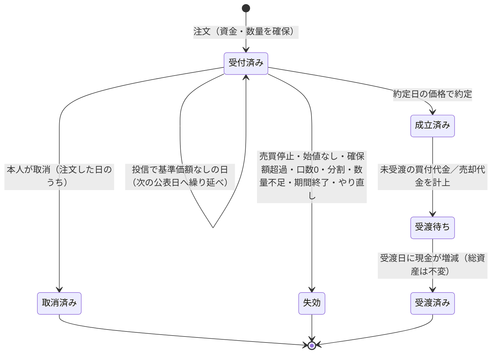

# 詳細設計: 計算・約定・受渡・端数処理（計算仕様版 1.4）

v1.3 からの変更: NISA口座と普通の口座の比較（§6b）を追加。口座の残高・損益の計算は変えていない（比較は表示用の概算で、口座からは何も引かない）。

v1.2 からの変更: 初期資金と毎月の追加資金を**参加者が自分で選べる**ようにした（§6a）。計算式は変えていない。

v1.1 からの変更: 期間の最終日より後に成立する注文を受け付けない／期間終了時に未成立の注文を失効／積立専用の最低金額・単位（`savings_min_amount`, `savings_amount_step`）と一括購入の可否（`spot_buy_ok`）／冪等キーを参加者の全試行で照合／投資信託の基準価額適用日の対応づけを明文化（§5）。

v1.0 からの主な変更: 買付代金・買付証券の**受渡**を導入（受渡前の売却不可・代金は受渡日に支払）、成行買いの確保ルールを商品条件化（値幅表または確保率、既定値なし）、配当の権利確定日を保持、分割の端数を**データで与えた端数処分代金のみ**で精算（終値による補完を廃止）、停止日の終値空欄を許可。

## 0. 数値の表現・精度・丸め・範囲
| 量 | 型・単位 | 丸め |
|---|---|---|
| 金額 | 円の整数 | 下記の各所で明示 |
| 株価・基準価額・1株配当 | 1/1000円の整数（milli）。入力は小数第3位まで | 入力時に第4位以降があればエラー（丸めない） |
| 株数・口数 | 整数 | — |
| 手数料率・留保額率 | ppm（100万分率）の整数 | — |

- 乗除はすべて BigInt で行い、結果が JavaScript の安全な整数（±9,007,199,254,740,991）を超えたら**例外**。例外はトランザクションごと取り消され、状態は変わらない（`server/money.js`）。
- 入力上限: 数量 1,000万、1回の投信注文・積立額 10億円、初期資金 100億円、毎月の追加資金 1億円、価格 1億円、1株配当 1,000万円、基準価額 1円以上。最大の積（数量1,000万 × 価格1億円 ＝ 1京円）でも安全整数内であることをテストで確認。
- 負値・指数表記・カンマ付きの数値は受け付けない。

## 1. 日付・カレンダー
- カレンダー＝取込データ内の価格日付の和集合。ある商品の行が欠ける営業日があるデータは**固定できない**（補完しない）。売買停止・基準価額なしは `status=halt` 行で明示し、終値は空欄でよい（その日は「価格更新なし」として直近の実在価格で評価）。
- 期間内で `sim_start` 以後の最初の営業日から開始し、`sim_end` 以前の最後の営業日が最終日。以後は閲覧のみ。**最終日より先には進行できない**（サーバーが拒否）。価格は取込データにある日付のものだけを使い、最終日より後の価格・評価額を作らない。
- 約定予定日が最終日より後になる注文は受け付けない。最終日の処理の最後に、成立していない注文（基準価額なしで繰り延べ中の投信注文など）は「期間終了のため失効」とし、確保を解放する。
- 締切: 注文はシミュレーション日付の「その日の終わり」に受け付けたものとして扱う。取消できるのは日付を進める前まで。申込不可日（海外市場の休業日など）は、データで `halt`（基準価額なし）として与えた日以外は再現しない。
- 「n営業日後」はこのカレンダー上で数える。期間外に出る受渡日は「期間外」（9999-12-31）として未受渡のまま総資産に計上する。

## 2. 価格と調整
**調整前の生価格のみ**受け付ける（`adjustment=raw_unadjusted` 必須）。配当・分割は `actions` で明示処理するため、調整済み価格の混在は取込エラーにする（二重反映の防止）。同一銘柄・同日に配当と分割は登録できない。

## 3. 口座の区分
| 区分 | 意味 |
|---|---|
| 現金残高 | 受渡済みの現金 |
| 注文拘束額 | 受付中の買い注文のために確保した額 |
| 未受渡の買付代金 | 約定済みで受渡日に支払う代金（手数料込み） |
| **買付可能額** | 現金残高 − 注文拘束額 − 未受渡の買付代金。**未受渡の売却代金は含めない**（初版の制限） |
| 未受渡の売却代金 | 約定済みで受渡日に受け取る代金（手数料・留保額控除後） |
| 未収配当等 | 確定済みで支払日を待つ配当・分配金・端数処分代金 |
| 保有（評価）数量 | 受渡前の買付分を含む数量。評価額は直近終値×数量（行ごとに切捨て） |
| 売却可能数量 | 保有数量 − 受渡前の買付数量 − 受付中の売り注文数量 |

**総資産** = 現金残高 + 保有評価額 − 未受渡の買付代金 + 未受渡の売却代金 + 未収配当等。
約定時は「保有+／未払代金+」、受渡時は「現金−／未払代金−」が同額で動くため、**受渡で総資産は変わらない**（売却・配当も対称）。運用損益 = 総資産 − 入金累計（税引前・手数料込み）。

> **初版の制限**: 受渡前に買った株式・口数の売却と、受渡前の売却代金による購入は認めない。実際の証券口座では可能な場合がある（すべての口座の挙動を再現したものではない）。

## 4. 株式・ETF（成行のみ）
- 注文はその営業日の終了時点で受け付け、翌営業日の**始値**で約定。注文受付の判断には注文日の終値（＝既知の情報）だけを使い、未来の始値は参照しない。
- 数量は売買単位の倍数。売りは単元倍数、または「全売却」（端株を含む売却可能全数。受渡前の買付分がある間は不可）。
- **確保価格**（商品条件。既定値なし。本番データでは未設定なら取込エラー）
  - `price_limit_table` = [[基準値段の上限(未満), 制限値幅], ...] がある場合: 確保価格 = 注文日終値 + 該当行の値幅 × `price_limit_multiplier`。表の範囲外の価格帯は受付不可。
  - それ以外は `buy_reserve_margin_bp`: 確保価格 = ceil(注文日終値 × (1 + bp/10000))。
  - 確保額 = ceil(数量 × 確保価格) + 手数料(その額)。買付可能額以下でなければ受付不可。
- **成立条件**: 約定日の行が `normal` で始値あり、かつ ceil(数量×始値) + 手数料 ≤ 確保額。満たさなければ**失効**し確保を解放（現金は動かない）→ 手数料や値上がりで負残高にならない。
- 売買停止・始値なし・値幅制限(limit)・価格行なし・分割の効力発生日の注文は**失効**（繰り越さない）。
- 買い約定: 保有に加え、取得額 = 約定代金+手数料、同額を未受渡の買付代金として受渡日（約定日+`settlement_days`営業日）に支払う。
- 売り約定: 約定代金 = floor(数量×始値)、受取 = max(0, 約定代金 − 手数料)。受渡日に現金化。取得額は保有数量比で按分（切捨て、全売却は全額）。
- 手数料 = clamp(floor(約定代金 × rate_ppm / 10^6) + fixed, min, max)。

## 5. 投資信託
- 金額指定購入は**手数料込み**。注文日の `nav_offset` 営業日後の基準価額で約定（注文時点では未知）。確保額＝申込金額。
- **基準価額適用日の対応づけ**: シミュレーション日付 D の終わりに出した注文は、D の基準価額を見たあとの注文なので、D+1 営業日の申込として扱う（既知の価格で約定させない）。したがって、目論見書で「申込受付日の基準価額」の商品は `nav_offset=1`、「申込受付日の翌営業日の基準価額」の商品は `nav_offset=2`。
- 購入の最低金額・単位は `min_amount`・`amount_step`。積立（定時定額）は `savings_min_amount`・`savings_amount_step`（未指定なら同じ）。`spot_buy_ok=false` の商品は積立でのみ購入できる。この区別はサーバーが注文の発生元で判定し、クライアントからは指定できない。
- 手数料 = clamp(floor(A × r / (10^6 + r)) + fixed, min, max)。正味 = A − 手数料。口数 = floor(正味 × 10^7 / 基準価額milli)。約定代金 = ceil(口数×基準価額milli / 10^7)。支払 = 約定代金+手数料（≤A、差額は拘束解除で戻る）。口数0なら失効。支払は約定日+`buy_settlement_days`営業日、それまでの口数は売却不可。
- 売却は口数指定（または全売却）。代金 = floor(口数×基準価額/10^7)、信託財産留保額 = floor(代金×holdback_ppm/10^6)、受取＝差引。受渡＝約定日+`settlement_days`営業日。
- 約定予定日の基準価額が `halt` なら次の公表日へ**繰り延べ**（確保維持、取消不可）。
- 分配金は現金受取のみ（再投資は取込エラー）。
- 積立: 投信のみ。毎月 `day_of_month`（1〜28）以降の最初の営業日にその日の注文を自動発注。設定・再開日が積立日より前なら当月から、以降なら翌月から。金額変更は次回の発注から。休止中は発注しない。買付可能額不足の月は**見送り**（自動停止、翌月に繰り越さない）。`plan_runs(plan_id, 年月)` の一意制約で二重発注を防止。

## 6. 配当・分配金・分割・追加資金
- データ項目: 権利落日 `ex_date`（投信は決算日）、権利確定日 `record_date`（本番データ必須）、支払日 `pay_date`、1株（1万口）あたり額 `per_unit`（税引前）。
- **権利判定**: 権利落日の処理開始時点（＝権利付最終日までの約定を反映済み）の保有数量。受渡前の買付分も含む（取引日基準）。権利落日以降の売却は受取、権利付最終日以前の売却は対象外。**支払時点の保有者には配賦しない。**
- 金額 = floor(数量 × per_unit)（投信は /1万口）。確定日から支払日まで未収配当として総資産に含め、支払日に現金化。
- 分割・併合 `num:den`（効力発生日 `ex_date`）: 新数量 = floor(旧×num/den)。受渡前の買付数量も ceil で換算（売却可能数量を多く見積もらない）。効力発生日に未約定の株式注文は失効。
- **端数**: num が den で割り切れない比率は、実データの端数処分代金 `fraction_price`（新株1株あたり）と支払日 `fraction_pay_date` が**必須**（無ければその商品は採用不可）。精算額 = floor(余り/den 株 × fraction_price)、支払日に入金。終値などで補完しない。
- 毎月の追加資金: 月が変わる最初の営業日の処理開始時に入金（台帳キー `deposit:YYYY-MM` で一意）。開始月は入れない。

## 6a. 参加者ごとの資金条件
- 参加時に「最初の金額（初期資金）」と「毎月入ってくる金額（毎月の追加資金）」を参加者が選ぶ。サーバーが検証する: 最初 0〜1,000万円、毎月 0〜30万円、いずれも1,000円単位の整数。両方0は不可。指定しなければ開催回の既定値。
- 値は試行（口座）ごとに保存し、初期入金（台帳キー `deposit:initial`）と月初の入金（`deposit:YYYY-MM`）に使う。運用損益 = 総資産 − 入金累計 の定義は変わらない。
- やり直しは、既定で前回と同じ条件。金額を指定すれば条件を変えられる。比較画面には各試行の条件を表示し、条件が異なる試行が含まれる場合はその旨を表示する（順位は付けない）。
- 開始時の質問（学年・毎月の収入・支出）は金額を決める手がかりで、**回答は端末の中だけで使い、サーバーへ送らない・保存しない**。サーバーが受け取るのは2つの金額だけ。画面は「収入 − 支出」の差し引きを表示するだけで、金額を提案・推奨しない。

## 6b. NISA口座と普通の口座（課税口座）の比較（概算）
- このシミュレーターの口座は、すべての買付をNISA口座で行ったものとして扱う（税金を引かない）。比較は「同じ取引を普通の口座で行っていたら」の概算で、表示だけに使う。
- 利益 G = 運用損益（総資産 − 入金累計。手数料控除後、含み損益を含む）。**いますべて売って損益を確定した**と仮定する。
- 税額 = G > 0 のとき floor(G × 15.315%) + floor(G × 5%)（所得税・復興特別所得税と住民税。各々円未満切り捨て）。G ≤ 0 のとき 0。普通の口座で手元に残る利益 = G − 税額。
- 省略していること: 年ごとの課税（年をまたぐ損益は通算したものとして扱う。損失の繰越控除を申告した場合に近い）、分配金の受取時の課税と普通分配金・元本払戻金の区別、売却時の信託財産留保額、特定口座・一般口座の違い、配当控除などの申告による差。
- 年間投資枠: 暦年ごとの買付代金（手数料を除く）の合計が360万円（つみたて投資枠120万円＋成長投資枠240万円）を超えた年を返し、画面に「実際には超えた分はNISA口座で買えない」と表示する。買付自体は止めない。生涯の上限（1,800万円）、売却による枠の復活、商品ごとの対象枠は扱わない。

## 7. 日次処理の順序（1営業日ずつ。早送りも同じ処理の繰り返し）
1 追加資金 → 2 分割 → 3 配当の確定 → 4 株式の約定 → 5 投信の約定 → 6 積立の発注 → 7 受渡・入金（買付代金の支払を含む）→ 8 ニュース・評価の記録・最終日判定。
恒等式（テストで全営業日検証）: 現金残高 = 台帳の現金系行の合計、現金残高 ≥ 0、買付可能額 ≥ 0、総資産 = 上記定義、台帳キー重複なし。

## 8. 注文の状態・取消・冪等

受付済み → 成立済み / 取消済み / 失効。確保（`reserve`）は受付時に1回だけ設定し、成立・取消・失効のいずれでも0に戻す（二重拘束・二重解放なし）。受渡は `receivables` の1行が `pending → paid` に1回だけ変わり、台帳キー `settle:<ref>` の一意制約で二重計上を防ぐ。取消は注文したシミュレーション日のうち（日付を進める前）のみ。更新系は `request_id` 必須で、同じIDの再送は保存済みの結果を返す（同じ参加者の全試行で照合）。`GET /api/requests/{id}` で受付状況を照会できる。`expected_sim_date` が現在日と違う操作は 409（複数タブ・古い画面）。

## 9. 時間進行・自動停止
1日／翌月初まで／月単位の自動進行（画面のタイマーがサーバーの「翌月へ」を繰り返し呼ぶ。計算・日付はサーバー）。停止条件: 手動注文の成立、売りの成立、失効、積立の見送り、新しいニュース、最終日。積立による自動の買い成立では止まらない（毎月止まると進められないため。画面では「進めた間の出来事」に種類ごとにまとめて表示）。資金不足は、積立の見送りとして停止する。ニュースは公表日の終了時点で表示。

## 10. 未来情報の遮断（サーバー側）
参加者APIは、その参加者のシミュレーション日付以前の価格・ニュースだけを返す。権利情報（配当・分割）は確定・効力発生後にのみ口座の記録として現れる。返す未来日付は約定予定日・受渡予定日・入金予定日・次回入金日・最終日だけ（テストで全APIを走査）。日付・参加者IDをクライアントから指定する経路はない。
同じ参加者の過去の試行（自分が体験済みの結果）は閲覧専用で表示し、比較は全試行に共通する日付時点で行う。

## 11. 再現していないこと
将来の価格・運用成果の予測や生成（仮定利回り・乱数・補間・外挿を含む）、投資信託の申込不可日、期間中の取引条件の変更（現在の条件を全期間に適用）、板・流動性・待ち順位・スリッページ、指値・日中売買・信用・空売り、NISAの制度計算（§6b の概算比較と年間投資枠の超過表示を除く）、実際の税金の計算、分配金再投資、株式の積立、受渡前の売却・未受渡代金での再購入、制限値幅の拡大・特別気配などの取引所の個別措置（データで halt/limit として与えたものを除く）。
